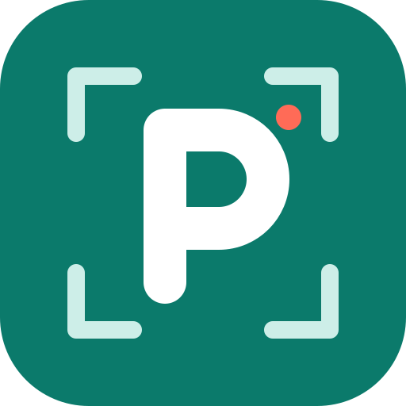

  

<h1 align="center">Posmed Studio</h1>

  Studio konten video edukasi tentang cara kerja benda di sekitar kita. 
  Dari riset, naskah, animasi, sampai tayang, semuanya dikerjakan dengan kode.

## Kanal

| Kanal | Isi | Tonton |
| --- | --- | --- |
| **Rodapedia** | Membongkar cara kerja kendaraan bersama Gero si ban dan Oli si tetes oli. Short setiap hari dan Bongkar Tuntas setiap Sabtu. | [YouTube](https://www.youtube.com/@rodapedia) · [TikTok](https://www.tiktok.com/@rodapedia) · [Instagram](https://www.instagram.com/rodapedia) |

## Cara kami bekerja

- **Fakta dulu.** Setiap naskah punya daftar sumber, dan angka di video harus bisa ditelusuri.
- **Animasi dari kode.** Adegan digambar dengan React dan Remotion, jadi bisa diperbaiki dan dirender ulang kapan saja.
- **Rekaman asli diberi kredit.** Klip video asli diambil dari sumber berlisensi bebas, dan pembuatnya dicatat.
- **Render otomatis.** Video dirender di GitHub Actions, lalu dikirim untuk dicek sebelum tayang.
